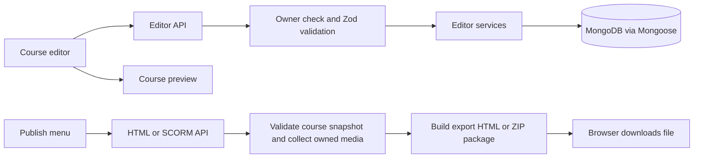
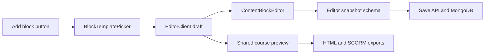

# Project guide

This guide is for people who need to find the code behind a screen or change how a course is saved, previewed, or exported. The app is one Next.js project. The `export/` folder is a separate browser-only build inside that project; it does not create another app or server.

## Find the file for a change

Start with the feature and the kind of change. Follow a page's imports to its controls, or follow an API handler's imports to its business rules. A component's filename describes its role; the containing route identifies the screen that owns it.

| What you want to change | Start here |
| --- | --- |
| Super Admin workspace list, search, and row actions | [workspace-management.tsx](../app/admin/workspaces/_components/workspace-management.tsx) |
| Super Admin workspace rename/delete dialog | [workspace-mutation-dialog.tsx](../app/admin/workspaces/_components/_components/workspace-mutation-dialog.tsx) |
| Workspace details and members shown to Super Admin | [workspace-detail.tsx](../app/admin/workspaces/[workspaceId]/_components/workspace-detail.tsx) |
| Workspace administration permissions, updates, and empty-workspace deletion | [lib/admin/workspaces.ts](../lib/admin/workspaces.ts) |
| Dashboard workspace creation and team management dialog | [workspace-manager-dialog.tsx](../app/dashboard/_components/workspace-manager-dialog.tsx) |
| Dashboard sidebar and workspace plus button | [dashboard-sidebar.tsx](<../app/dashboard/_components/(dashboard_client_components)/dashboard-sidebar.tsx>) |
| Course editor screen and lesson/block actions | [editor-client.tsx](../app/courses/[courseId]/edit/_components/editor-client.tsx) |
| Autosave, revision conflicts, undo, and redo | [use-editor-draft.ts](../app/courses/[courseId]/edit/_components/_components/use-editor-draft.ts) |
| An image block's author settings | [image-block-settings.tsx](<../app/courses/[courseId]/edit/_components/(editor_client_components)/(content_block_editor_components)/_components/block-settings/image-block-settings.tsx>); other block settings are beside it |
| How a block looks to a learner | [preview-block.tsx](<../app/courses/[courseId]/preview/_components/(course_preview_components)/(lesson_reader_preview_components)/(lesson_blocks_preview_components)/preview-block.tsx>) |
| AI prompts and provider calls | [prompts.ts](../lib/ai/generation/prompts.ts) and [provider.ts](../lib/ai/generation/provider.ts) |
| Save validation and database writes | [lib/editor/schemas.ts](../lib/editor/schemas.ts) and [save.ts](../lib/editor/services/save.ts) |
| Verification commands, browser tests, or the 100-author benchmark | [Verification baseline](verification-baseline.md) |

### Follow the route

For `/admin/workspaces`, open `app/admin/workspaces/page.tsx`. Its imports lead to the page's `_components/`. The corresponding HTTP handlers are under `app/api/admin/workspaces/`; their imports lead to `lib/admin/workspaces.ts`. Paths containing `[workspaceId]` or `[courseId]` handle a specific record.

Super Admin workspace administration belongs to `lib/admin/workspaces.ts`. Ordinary team creation, membership, and invitation operations belong to `lib/workspaces/services.ts`. Choose the entry point for the screen and user role whose behavior you are changing.

Use the same route-first approach for other features: page composition in `page.tsx`, page controls in its `_components/`, HTTP behavior in `app/api/`, domain rules in `lib/`, persisted fields/indexes in `models/`, and related behavior tests in `tests/`. Shared primitives live in `components/ui/`. Admin dialogs may have another `_components/` below the page's components; editor controls also have named parent folders such as `(editor_client_components)`.

### Search by filename or visible text

In VS Code, use **Ctrl+P** and type `workspace-management`, `use-editor-draft`, or part of the owning route. Use **Ctrl+Shift+F** for text displayed on the screen, then **F12** on an imported component or service to follow its definition. Searching by a descriptive filename avoids opening every nested folder.

From the terminal:

```sh
rg --files app lib tests | rg 'workspace|use-editor-draft|image-block-settings'
rg -n 'Create team workspace' app
```

When moving or renaming a source file, update its entry in this guide with the code change. Source imports and exports are the final authority when investigating behavior.

## Main workflows



Course editing starts at `app/courses/[courseId]/edit/page.tsx`. That server page checks authentication, loads the owner-scoped course, and passes it to `EditorClient`. The client editor is in `app/courses/[courseId]/edit/_components/editor-client.tsx`; its smaller editing controls live beside it in `_components/`. Saves go to `app/api/courses/[courseId]/editor/route.ts`, which validates the request with `lib/editor/schemas.ts` and calls `lib/editor/services/save.ts`. The service writes the course and lesson documents through Mongoose and checks the course revision so an older browser tab cannot silently overwrite newer edits.

The preview uses `app/courses/[courseId]/preview/course-preview.tsx` for the learner view. The authenticated preview route adds authoring navigation and device controls around the same view. The static course export also imports this learner view, so visual or learning-navigation changes should be checked in both preview and downloaded exports.

## API routes and service functions

API files are located under `app/api/`; each directory's `route.ts` exports the HTTP methods it accepts. Route handlers should stay small: check the signed-in owner, connect to MongoDB, validate route parameters/body, call a function under `lib/`, then return a JSON or file response.

Most authenticated handlers use three shared helpers from `lib/dashboard/http.ts`:

| Function                        | What it does                                                                                                                           |
| ------------------------------- | -------------------------------------------------------------------------------------------------------------------------------------- |
| `requireOwnerId()`              | Reads the Auth.js session and returns the signed-in user ID, or raises a 401 error.                                                    |
| `readJson(request, schema)`     | Parses a JSON request body with the supplied Zod schema and returns a clear 400 error for invalid input.                               |
| `dashboardErrorResponse(error)` | Converts known `DashboardError` and Zod errors to JSON and status codes; hides unexpected server errors behind a generic 500 response. |

Handlers also call `connectToDatabase()` from `lib/db/mongodb.ts`. `lib/dashboard/services/internal.ts` provides owner/ObjectId conversion and folder ownership/uniqueness helpers. `lib/dashboard/rules.ts` contains shared domain errors and rules. The Auth.js callback route is the exception: it delegates directly to the handlers in `lib/auth/`.

### Dashboard, courses, and folders

| HTTP route                             | Route file                                    | Library functions and behavior                                                                                                                                                                                                         |
| -------------------------------------- | --------------------------------------------- | -------------------------------------------------------------------------------------------------------------------------------------------------------------------------------------------------------------------------------------- |
| `GET /api/dashboard`                   | `app/api/dashboard/route.ts`                  | Calls `getDashboardData()` in `lib/dashboard/services/list.ts`. Query parameters can filter by `folderId`, search with `q`, filter by `status`, and sort. Returns dashboard folders, courses, counts, breadcrumbs, and folder choices. |
| `GET /api/courses`                     | `app/api/courses/route.ts`                    | Calls `getDashboardData()` and returns its course list, with optional `folderId` and `q`.                                                                                                                                              |
| `POST /api/courses`                    | `app/api/courses/route.ts`                    | Validates `createCourseSchema`, then calls `createCourse()` in `lib/dashboard/services/courses.ts`. Creates a draft course and its initial section.                                                                                    |
| `PATCH /api/courses/[courseId]`        | `app/api/courses/[courseId]/route.ts`         | Validates `updateCourseSchema`, then calls `updateCourse()` to change course metadata, folder, or status. It checks ownership and conflicts with editor saves.                                                                         |
| `GET /api/courses/[courseId]`          | `app/api/courses/[courseId]/route.ts`         | Calls `getCourseCopyDestinations()`; this endpoint supplies the list of other courses available when copying content.                                                                                                                  |
| `POST /api/courses/[courseId]`         | `app/api/courses/[courseId]/route.ts`         | Calls `duplicateCourse()` to create a new draft course based on the selected course.                                                                                                                                                   |
| `DELETE /api/courses/[courseId]`       | `app/api/courses/[courseId]/route.ts`         | Validates the confirmation title, then calls `softDeleteCourse()`. It marks the course deleted instead of immediately removing its records.                                                                                            |
| `POST /api/courses/[courseId]/restore` | `app/api/courses/[courseId]/restore/route.ts` | Calls `restoreCourse()` to clear the course's `deletedAt` field.                                                                                                                                                                       |
| `GET /api/folders`                     | `app/api/folders/route.ts`                    | Calls `getDashboardData()` and returns folders under the optional `parentId`.                                                                                                                                                          |
| `POST /api/folders`                    | `app/api/folders/route.ts`                    | Validates `createFolderSchema`, then calls `createFolder()`. The service checks parent ownership and unique names.                                                                                                                     |
| `PATCH /api/folders/[folderId]`        | `app/api/folders/[folderId]/route.ts`         | Validates `updateFolderSchema`, then calls `updateFolder()` to rename or move a folder while checking for circular ancestry.                                                                                                           |
| `DELETE /api/folders/[folderId]`       | `app/api/folders/[folderId]/route.ts`         | Calls `deleteFolder()`. The service refuses to delete a folder while it contains courses or subfolders.                                                                                                                                |

The course and folder functions live in `lib/dashboard/services/courses.ts` and `lib/dashboard/services/folders.ts`; the shared listing/tree logic is in `lib/dashboard/services/list.ts`. Request schemas and ObjectId validation are in `lib/dashboard/schemas.ts`.

### Course editor and lesson content

| HTTP route                                  | Route file                                         | Library functions and behavior                                                                                                                                                                                                                                     |
| ------------------------------------------- | -------------------------------------------------- | ------------------------------------------------------------------------------------------------------------------------------------------------------------------------------------------------------------------------------------------------------------------ |
| `GET /api/courses/[courseId]/editor`        | `app/api/courses/[courseId]/editor/route.ts`       | Calls `getCourseEditor()` in `lib/editor/services/course.ts`. Returns course metadata, ordered sections, lessons, blocks, and the current revision.                                                                                                                |
| `PUT /api/courses/[courseId]/editor`        | `app/api/courses/[courseId]/editor/route.ts`       | Validates the full snapshot with `editorSnapshotSchema`, then calls `saveCourseEditor()` in `lib/editor/services/save.ts`. Saves course and lesson documents together, using a MongoDB transaction when supported and a revision lock/rollback fallback otherwise. |
| `POST /api/courses/[courseId]/lessons`      | `app/api/courses/[courseId]/lessons/route.ts`      | Calls `addCourseLesson()` in `lib/editor/services/lessons.ts`. Adds a new lesson to the first section and advances the course revision.                                                                                                                            |
| `POST /api/courses/[courseId]/lessons/copy` | `app/api/courses/[courseId]/lessons/copy/route.ts` | Validates a destination course and lesson with `editorLessonSchema`, then calls `copyCourseLesson()`. The service checks ownership of both courses and creates fresh IDs for the copied lesson, blocks, quiz questions, and choices.                               |

Content and quiz shapes are defined in `lib/schemas/block.ts`, `lib/schemas/quiz.ts`, and `lib/editor/schemas.ts`. When adding a field to editable content, update the schema and the editor/preview that reads it; autosave and exports consume the same snapshot shape.

### Media library and storage providers

| HTTP route                                               | Route file                                                      | Library functions and behavior                                                                                                                                                          |
| -------------------------------------------------------- | --------------------------------------------------------------- | --------------------------------------------------------------------------------------------------------------------------------------------------------------------------------------- |
| `GET /api/courses/[courseId]/assets`                     | `app/api/courses/[courseId]/assets/route.ts`                    | Calls `assertCourseOwner()` and `listCourseMedia()` in `lib/media/services/course-assets.ts`. Returns ready assets with authenticated file URLs.                                        |
| `POST /api/courses/[courseId]/assets`                    | `app/api/courses/[courseId]/assets/route.ts`                    | Calls `beginMediaUpload()` after validation. Creates a pending asset and returns S3 POST fields or an authenticated local PUT URL for the selected provider. |
| `PUT /api/courses/[courseId]/assets/[assetId]/upload`   | `app/api/courses/[courseId]/assets/[assetId]/upload/route.ts` | Validates access, origin, and pending asset metadata before streaming a local upload. |
| `POST /api/courses/[courseId]/assets/[assetId]/complete` | `app/api/courses/[courseId]/assets/[assetId]/complete/route.ts` | Calls `completeMediaUpload()` to verify the stored file's size, provider metadata, and signature before marking it ready. |
| `DELETE /api/courses/[courseId]/assets/[assetId]`        | `app/api/courses/[courseId]/assets/[assetId]/route.ts`          | Calls `deleteCourseMediaAsset()` to remove the file through its saved provider and then its asset record. |
| `GET /api/assets/[assetId]/file`                         | `app/api/assets/[assetId]/file/route.ts`                        | Calls `getOwnedMediaAsset()` and `readStoredMedia()` to stream the file after current access checks, including byte-range requests. |

Upload lifecycle functions are in `lib/media/services/uploads.ts`; course listing/deletion and access checks are in `lib/media/services/course-assets.ts`. `lib/media/service.ts` resolves each asset's saved provider and directory; adapters live in `lib/media/providers/`, with S3 signing helpers in `lib/media/storage.ts`. The UI is `app/courses/[courseId]/edit/_components/media-library-dialog.tsx`. Super Admin storage controls live in `app/admin/settings/media-storage/_components/media-storage-management.tsx`.

### Authentication and publishing

| HTTP route                                       | Route file                                              | Library functions and behavior                                                                                                                                                                                                                                                        |
| ------------------------------------------------ | ------------------------------------------------------- | ------------------------------------------------------------------------------------------------------------------------------------------------------------------------------------------------------------------------------------------------------------------------------------- |
| `GET` and `POST /api/auth/[...nextauth]`         | `app/api/auth/[...nextauth]/route.ts`                   | Re-exports the Auth.js handlers from `lib/auth/`.                                                                                                                                                                                                                                     |
| `POST /api/courses/[courseId]/publish`           | `app/api/courses/[courseId]/publish/route.ts`           | Checks publish/export access, loads the saved course and scoped assets, and uses `storedMediaBytes()` to embed media. Its `replaceAssetSources()` helper rewrites asset URLs to data URLs; it embeds built JS/CSS and returns one `.html` download. |
| `POST /api/courses/[courseId]/publish/pdf`        | `app/api/courses/[courseId]/publish/pdf/route.ts`       | Calls `buildCourseHandoutPdf()` to validate the course, include owner-scoped PNG/JPEG images, and return a printable `.pdf` handout. |
| `POST /api/courses/[courseId]/publish/scorm12`   | `app/api/courses/[courseId]/publish/scorm12/route.ts`   | Calls `buildScorm12Package()` in `lib/scorm/package.ts`, then returns the generated ZIP.                                                                                                                                                                                              |
| `POST /api/courses/[courseId]/publish/scorm2004` | `app/api/courses/[courseId]/publish/scorm2004/route.ts` | Calls `buildScorm2004Package()` in `lib/scorm/package.ts`, then returns the generated ZIP.                                                                                                                                                                                            |

The publish routes check the signed-in owner before loading or packaging a course. `lib/scorm/package.ts` validates the editor snapshot, includes only media records owned by that user and course, copies the export bundle and schemas, builds the selected manifest, and creates the ZIP. The package helpers and SCORM runtime are mapped in the publishing section below.

Publishing starts from the shared `components/publish-menu.tsx`. It calls an authenticated API route, which loads the current saved course, validates and packages it, then returns a file for the browser to download. Build the static export before publishing:

```bash
npm run build:export
```

This creates generated files under `public/course-export/`. That folder is ignored by Git; change the source under `export/`, then rebuild. Production deployments that offer export downloads must run this build before serving publish requests.

## Folder map

| Location                                   | What belongs there                                                                                                                                                                      |
| ------------------------------------------ | --------------------------------------------------------------------------------------------------------------------------------------------------------------------------------------- |
| `app/`                                     | Next.js pages, layouts, client screens, and API routes. Route-specific UI stays next to its page.                                                                                       |
| `app/admin/` | Admin pages with their own `_components/`; shared admin navigation and helpers stay in `app/admin/_components/`. |
| `app/courses/[courseId]/edit/_components/` | Course outline, section and lesson editing, content blocks, quiz editor, formatting controls, and media dialog.                                                                         |
| `app/courses/[courseId]/preview/`          | Shared learner preview, preview route wrapper, interactive knowledge-check/survey controls, and preview-only image behavior.                                                            |
| `app/api/`                                 | Server endpoints. Handlers authenticate/authorize, validate requests, call services, and shape HTTP responses.                                                                          |
| `components/ui/`                           | Shared shadcn-style source primitives: Button, Input, Select, Textarea, Card, and Badge. Extend and reuse these for consistent controls.                                                |
| `components/`                              | Reusable application-level components, such as the shared publish dropdown.                                                                                                             |
| `lib/`                                     | Domain logic, validation, database helpers, media operations, and export packaging. Keep business rules out of presentational components.                                               |
| `models/`                                  | Mongoose models and indexes for courses, lessons, folders, media assets, and users.                                                                                                     |
| `export/`                                  | Browser-only Vite entry point, shared learner view bootstrap, SCORM runtime adapter, and export build config. Do not import server APIs, MongoDB, Auth.js, or private credentials here. |
| `public/scorm12/schema/`                   | SCORM 1.2 XML schemas copied into exported packages.                                                                                                                                    |
| `public/scorm2004/schema/`                 | SCORM 2004 XML schemas copied into exported packages.                                                                                                                                   |
| `public/course-export/`                    | Generated static build output. Do not edit this by hand.                                                                                                                                |
| `tests/`                                   | Vitest tests for schemas, editor rules, preview, publishing, and SCORM package behavior.                                                                                                |
| `e2e/` | Production browser smoke tests, started through `scripts/run-e2e.mjs`. |
| `scripts/testing/`, `scripts/performance/` | Isolated database/application lifecycle, fixtures, and author workload measurements. |
| `.github/workflows/ci.yml` | Automated Linux verification, Windows unit checks, and optional performance run. |
| `docs/`                                    | Architecture, database, media, SCORM, roadmap, and this project guide.                                                                                                                  |

The main library areas are:

| Library folder     | Purpose                                                                                                            |
| ------------------ | ------------------------------------------------------------------------------------------------------------------ |
| `lib/auth/`        | Auth.js configuration and session helpers.                                                                         |
| `lib/admin/` | Administration queries, mutations, permissions, audit transactions, and input schemas. |
| `lib/workspaces/` | Workspace membership, invitations, access checks, and ordinary team operations. |
| `lib/ai/` | Generation workflows, validation, source processing, provider requests, and retries. |
| `lib/db/`          | MongoDB connection setup.                                                                                          |
| `lib/dashboard/`   | Dashboard request validation, ownership helpers, and course/folder services.                                       |
| `lib/editor/`      | Editor snapshot schemas, course/lesson loading, save logic, and text formatting.                                   |
| `lib/export/`      | Learner progress contracts and progress calculations shared by preview and exports.                                |
| `lib/interactive/` | Reusable learner interaction and quiz assessment rules, including answer grading and export validation.            |
| `lib/media/`       | Media validation, local/S3 providers, storage settings, and course-asset services. |
| `lib/pdf/`         | PDF handout content conversion, rendering, and licensed Latin/Khmer font files.                                    |
| `lib/schemas/`     | Shared versioned course, block, and quiz content schemas.                                                          |
| `lib/scorm/`       | Shared SCORM packaging and the SCORM 2004 manifest.                                                                |
| `lib/scorm12/`     | SCORM 1.2 manifest, snapshot validation, and ZIP helper; the snapshot and ZIP helpers are also used by SCORM 2004. |

## UI components and libraries

Use `components/ui/` for common buttons and fields. Use a route's `_components/` folder for controls that only make sense on that screen. For example, edit quiz behavior in `app/courses/[courseId]/edit/_components/(editor_client_components)/quiz-editor.tsx`; edit the general button primitive in `components/ui/button.tsx`. The course editor currently uses `@dnd-kit` for sortable content, TipTap for rich text, `lucide-react` for icons, and Framer Motion for animations.

The main libraries are:

| Library                              | Use in this project                                                       |
| ------------------------------------ | ------------------------------------------------------------------------- |
| Next.js App Router and React         | Application pages, server routes, and interactive components.             |
| TypeScript                           | Strict types shared across UI, services, and export code.                 |
| Tailwind CSS and local UI primitives | Styling and consistent authoring controls.                                |
| Mongoose and MongoDB                 | Persistent course, lesson, folder, and media metadata.                    |
| Auth.js                              | Sign-in and session identity. Server routes still check record ownership. |
| Zod                                  | Validation of editor snapshots, API input, and content schemas.           |
| TipTap                               | Rich text editing and formatted course content.                           |
| `@dnd-kit`                           | Reordering sections, lessons, and blocks.                                 |
| AWS SDK                              | Private S3 media uploads, reads, and deletes.                             |
| Vite                                 | Builds `export/` into static browser assets.                              |
| Vitest and jsdom                     | Unit and component behavior tests.                                        |

## Extending the lesson block editor

Lesson blocks use a shared, versioned data contract. `blockTypes` in `lib/schemas/block.ts` is the current catalog. A saved block includes its `id`, version, type-specific `data`, width, background color, and padding. The same schema module defines accepted values and defaults.

The editor flow is:



| Change needed | Source files | Responsibility |
| --- | --- | --- |
| Block data, required fields, defaults, width and padding | [block.ts](<../lib/schemas/block.ts>) | Update the versioned Zod contract and defaults. |
| Whole-editor save validation | [schemas.ts](<../lib/editor/schemas.ts>) | Validate cross-block and course-level requirements. |
| Template categories and presets | [block-template-data.ts](<../app/courses/[courseId]/edit/_components/(editor_client_components)/(block_template_picker_components)/block-template-data.ts>) | Edit blockCategories, BlockTemplate, and blockTemplates. |
| Template insertion and picker previews | [create-blocks-from-template.ts](<../app/courses/[courseId]/edit/_components/(editor_client_components)/(block_template_picker_components)/create-blocks-from-template.ts>) and [template-preview.tsx](<../app/courses/[courseId]/edit/_components/(editor_client_components)/(block_template_picker_components)/template-preview.tsx>) | Build typed blocks and render their picker thumbnails. |
| Lesson/block actions and template selection | [editor-client.tsx](<../app/courses/[courseId]/edit/_components/editor-client.tsx>) | Insert, update, duplicate, delete, replace, and reorder draft content; select the template category. |
| Autosave, conflicts, history, and save-before-navigation | [use-editor-draft.ts](<../app/courses/[courseId]/edit/_components/_components/use-editor-draft.ts>) | Keep pending saves serialized and preserve revision checks and undo/redo. |
| Block controls and media selection | [content-block-editor.tsx](<../app/courses/[courseId]/edit/_components/(editor_client_components)/content-block-editor.tsx>) and [block-settings/](<../app/courses/[courseId]/edit/_components/(editor_client_components)/(content_block_editor_components)/_components/block-settings/>) | Wire the active block; edit its focused settings component. |
| Preview inside block settings | [content-block-preview.tsx](<../app/courses/[courseId]/edit/_components/(editor_client_components)/(content_block_editor_components)/_components/content-block-preview.tsx>) | Render the author-facing block preview. |
| Rich text and heading editing | [rich-text-block-editor.tsx](<../app/courses/[courseId]/edit/_components/(editor_client_components)/(content_block_editor_components)/rich-text-block-editor.tsx>) and [heading-block-editor.tsx](<../app/courses/[courseId]/edit/_components/(editor_client_components)/(content_block_editor_components)/heading-block-editor.tsx>) | Change focused text editors; toolbar controls live under (text_editing_components). |
| Text formatting toolbar | [text-formatting-toolbar.tsx](<../app/courses/[courseId]/edit/_components/(editor_client_components)/(text_editing_components)/text-formatting-toolbar.tsx>) | Follow its imports for formatting commands and individual controls. |
| Statement authoring and learner appearance | [statement-content-editor.tsx](<../app/courses/[courseId]/edit/_components/(editor_client_components)/(content_block_editor_components)/statement-content-editor.tsx>) and [statement-block-preview.tsx](<../app/courses/[courseId]/edit/_components/statement-block-preview.tsx>) | Change statement settings and shared rendering. |
| Width, background, padding, and drag controls | [block-format-menu.tsx](<../app/courses/[courseId]/edit/_components/(editor_client_components)/block-format-menu.tsx>) and [sortable-item.tsx](<../app/courses/[courseId]/edit/_components/(editor_client_components)/sortable-item.tsx>) | Keep controls aligned with schema defaults and ordering in editor-client.tsx. |
| Learner-facing block rendering and activities | [preview-block.tsx](<../app/courses/[courseId]/preview/_components/(course_preview_components)/(lesson_reader_preview_components)/(lesson_blocks_preview_components)/preview-block.tsx>) and [interactive-blocks.tsx](<../app/courses/[courseId]/preview/interactive-blocks.tsx>) | Render each block and follow imports to its stateful learner controls. |
| Continue gates and course progress | [lesson-blocks-preview.tsx](<../app/courses/[courseId]/preview/_components/(course_preview_components)/(lesson_reader_preview_components)/lesson-blocks-preview.tsx>) and [course-preview.tsx](<../app/courses/[courseId]/preview/course-preview.tsx>) | Change block visibility, completion, and navigation behavior; pure progress rules live in lib/export/progress.ts. |
| Knowledge-check correctness and quiz scoring | [knowledge-check.ts](<../lib/interactive/knowledge-check.ts>) and [quiz-assessment.ts](<../lib/interactive/quiz-assessment.ts>) | Keep evaluation rules independently testable. |
| Quiz authoring and learner attempts | [quiz-editor.tsx](<../app/courses/[courseId]/edit/_components/(editor_client_components)/quiz-editor.tsx>) and [quiz-assessment-preview.tsx](<../app/courses/[courseId]/preview/_components/(course_preview_components)/(lesson_reader_preview_components)/quiz-assessment-preview.tsx>) | Change question editing, passing scores, attempts, and retry UI. |
| Resume data and LMS reporting | [progress.ts](<../lib/export/progress.ts>) and [scorm-runtime.ts](<../export/src/scorm-runtime.ts>) | Preserve learner state and report scores/completion. |
| Saved content loading and persistence | [course.ts](<../lib/editor/services/course.ts>) and [save.ts](<../lib/editor/services/save.ts>) | Normalize older content, validate access and revisions, and write course/lesson documents. |
| Related behavior checks | [editor-draft.test.tsx](<../tests/editor-draft.test.tsx>), [content-block-settings.test.ts](<../tests/content-block-settings.test.ts>), and [course-preview-progress.test.ts](<../tests/course-preview-progress.test.ts>) | Find adjacent schema, template, activity, and export tests by feature name. |

To add a completely new block type, follow this order:

1. Define its data schema in `lib/schemas/block.ts`; add it to `blockTypes` and the `blockSchema` discriminated union. Keep `version` compatible with existing records, and use defaults for new optional fields so older saved courses still load.
2. Set its default width and padding in the same schema module. The editor and preview both read these values.
3. Wire the type into `ContentBlockEditor` and put its controls alongside the existing `*-block-settings.tsx` components. Use `ContentBlock` narrowing (for example, `Extract<ContentBlock, { type: "image" }>` in a prop type) so data fields stay type-checked.
4. Add a learner rendering branch in `preview-block.tsx`. HTML and both SCORM exports reuse this learner renderer. Update `content-block-preview.tsx` for the editor's settings preview where applicable.
5. Update `BlockTemplate` and the catalog in `block-template-data.ts`, its factory in `create-blocks-from-template.ts`, and its picker rendering in `template-preview.tsx`. Update `getTemplateCategory()` in `editor-client.tsx` if the type should open a specific category when replacing it.
6. Add tests for its schema, editor defaults, templates, and preview. Run typecheck and tests, then `npm run build:export` to verify the browser-only bundle still compiles.

For a caption setting, update the type's data schema, its focused block settings component, its learner rendering in `preview-block.tsx`, and matching schema/preview tests. Update `content-block-preview.tsx` if its settings preview uses that field. Include new data fields in the schema so validation accepts and preserves them.

Quizzes are lesson-level content, not members of the `ContentBlock` union. Edit question data in `lib/schemas/quiz.ts`, the passing-score contract in `lib/editor/schemas.ts`, authoring UI in `quiz-editor.tsx`, and learner behavior in `quiz-assessment-preview.tsx`. Their current paths are linked in the table above. Publishing validates that each quiz has a question prompt, filled answer choices, and at least one correct answer. The shared preview stores the best score and passed status in standalone or SCORM resume data.

Knowledge-check answers and survey ratings provide interaction and feedback in the browser session; those responses are not sent to an author response API or stored as course results. Lesson-level quiz assessments are graded separately and report aggregate scores through the SCORM LMS adapter.

## Where to edit AI generation

| Change needed | Source files |
| --- | --- |
| Author prompt, uploads, progress, and review UI | [course-generation-dialog.tsx](<../app/courses/[courseId]/edit/_components/(editor_client_components)/course-generation-dialog.tsx>) and its (course_generation_dialog_components) children |
| Workflow stages, job/checkpoint coordination, and applying drafts | [course-generation.ts](<../lib/ai/course-generation.ts>) |
| Prompts and learner language | [prompts.ts](<../lib/ai/generation/prompts.ts>) and [language.ts](<../lib/ai/generation/language.ts>) |
| Provider HTTP calls, structured output, and retry handling | [provider.ts](<../lib/ai/generation/provider.ts>) and [generation-retry.ts](<../lib/ai/generation-retry.ts>) |
| User input/generated draft contracts and provider response contracts | [course-generation-schemas.ts](<../lib/ai/course-generation-schemas.ts>) and [response-schemas.ts](<../lib/ai/generation/response-schemas.ts>) |
| Source indexing, mapping, and coverage | [source-document.ts](<../lib/ai/source-document.ts>), [source-inventory.ts](<../lib/ai/generation/source-inventory.ts>), and [source-coverage.ts](<../lib/ai/generation/source-coverage.ts>) |
| Generated blocks and images | [block-content.ts](<../lib/ai/generation/block-content.ts>) and [images.ts](<../lib/ai/generation/images.ts>) |

For a server-side generation change, follow the coordinator into the relevant leaf module and check tests/course-generation.test.ts plus the focused source/retry tests. For UI behavior, start with tests/course-generation-dialog.test.tsx. Keep provider keys on the server.

## Where to edit publishing and SCORM

| Change needed                                                                            | Edit here                                                                        |
| ---------------------------------------------------------------------------------------- | -------------------------------------------------------------------------------- |
| Publish button, menu labels, or which endpoint is called                                 | `components/publish-menu.tsx`                                                    |
| Downloadable standalone HTML                                                             | `app/api/courses/[courseId]/publish/route.ts`                                    |
| PDF handout generation and text conversion                                               | `lib/pdf/course-handout.ts` and `lib/pdf/content.ts`                             |
| PDF handout response and ownership/authentication checks                                 | `app/api/courses/[courseId]/publish/pdf/route.ts`                                |
| SCORM 1.2 response and ownership/authentication checks                                   | `app/api/courses/[courseId]/publish/scorm12/route.ts`                            |
| SCORM 2004 response and ownership/authentication checks                                  | `app/api/courses/[courseId]/publish/scorm2004/route.ts`                          |
| Shared ZIP contents, included media, export assets, filenames, or manifest selection     | `lib/scorm/package.ts`                                                           |
| Check that a course snapshot is valid and has exportable lessons                         | `lib/scorm12/snapshot.ts` (shared by both SCORM versions)                        |
| SCORM 1.2 manifest XML                                                                   | `lib/scorm12/manifest.ts`                                                        |
| SCORM 2004 manifest XML                                                                  | `lib/scorm/manifest-2004.ts`                                                     |
| ZIP file encoding                                                                        | `lib/scorm12/zip.ts` (used by both versions)                                     |
| LMS API discovery, progress save/resume, completion, commits, or SCORM data model fields | `export/src/scorm-runtime.ts`                                                    |
| What counts as lesson completion or the learner progress percentage                      | `lib/export/progress.ts` and `app/courses/[courseId]/preview/course-preview.tsx` |
| Static export entry point and shared learner view bootstrap                              | `export/src/main.ts`                                                             |
| Static export build path or bundler settings                                             | `export/vite.config.ts`; the command is `build:export` in `package.json`         |
| SCORM 1.2 schema files in the package                                                    | `public/scorm12/schema/`                                                         |
| SCORM 2004 schema files in the package                                                   | `public/scorm2004/schema/`                                                       |

Both SCORM formats use `lib/scorm/package.ts` and `export/src/scorm-runtime.ts`. The runtime detects the LMS API: `API` for SCORM 1.2 and `API_1484_11` for SCORM 2004. It stores resume details in `cmi.suspend_data` and updates completion status. SCORM 2004 also writes the numeric `cmi.progress_measure`; SCORM 1.2 has no equivalent standard overall percentage field. If changing progress behavior, update the shared progress calculation and LMS adapter, then test each format separately.

For a quick starting point: change `lib/scorm/package.ts` for what files go into the ZIP; change `export/src/scorm-runtime.ts` for LMS progress and completion behavior; change `lib/scorm12/manifest.ts` or `lib/scorm/manifest-2004.ts` for format-specific manifest XML.

The runtime and package helpers are covered by `tests/scorm12.test.ts`. Add or update focused tests there when changing manifests, LMS fields, completion, or ZIP contents. Keep manifest schema filenames and package paths in sync with the schema directories and with the manifest's file list.

## Local checks

```bash
npm run check
npm run build:export
npm run test:e2e
```

`npm run check` runs lint, strict types, and the full Vitest suite using isolated MongoDB. `npm run test:e2e` builds the existing application and runs browser tests with synthetic accounts and test data. See [Verification baseline](verification-baseline.md) for prerequisites and the performance command.

Run `npm run build:export` after changing `export/` or shared learner UI and before manually testing HTML or SCORM downloads. Never put credentials in source files; document new environment variables in `.env.example`.
