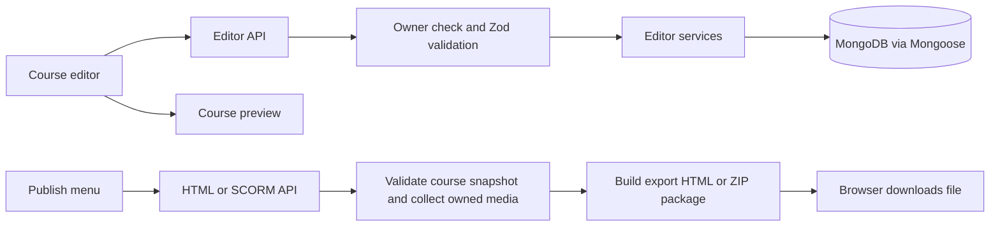
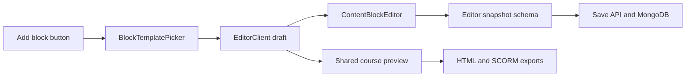

# Project guide

This guide is for people who need to find the code behind a screen or change how a course is saved, previewed, or exported. The app is one Next.js project. The `export/` folder is a separate browser-only build inside that project; it does not create another app or server.

## Main workflows



Course editing starts at `app/courses/[courseId]/edit/page.tsx`. That server page checks authentication, loads the owner-scoped course, and passes it to `EditorClient`. The client editor is in `app/courses/[courseId]/edit/_components/editor-client.tsx`; its smaller editing controls live beside it in `_components/`. Saves go to `app/api/courses/[courseId]/editor/route.ts`, which validates the request with `lib/editor/schemas.ts` and calls `lib/editor/services/save.ts`. The service writes the course and lesson documents through Mongoose and checks the course revision so an older browser tab cannot silently overwrite newer edits.

The preview uses `app/courses/[courseId]/preview/course-preview.tsx` for the learner view. The authenticated preview route adds authoring navigation and device controls around the same view. The static course export also imports this learner view, so visual or learning-navigation changes should be checked in both preview and downloaded exports.

## API routes and service functions

API files are located under `app/api/`; each directory's `route.ts` exports the HTTP methods it accepts. Route handlers should stay small: check the signed-in owner, connect to MongoDB, validate route parameters/body, call a function under `lib/`, then return a JSON or file response.

Most authenticated handlers use three shared helpers from `lib/dashboard/http.ts`:

| Function | What it does |
|---|---|
| `requireOwnerId()` | Reads the Auth.js session and returns the signed-in user ID, or raises a 401 error. |
| `readJson(request, schema)` | Parses a JSON request body with the supplied Zod schema and returns a clear 400 error for invalid input. |
| `dashboardErrorResponse(error)` | Converts known `DashboardError` and Zod errors to JSON and status codes; hides unexpected server errors behind a generic 500 response. |

Handlers also call `connectToDatabase()` from `lib/db/mongodb.ts`. `lib/dashboard/services/internal.ts` provides owner/ObjectId conversion and folder ownership/uniqueness helpers. `lib/dashboard/rules.ts` contains shared domain errors and rules. The Auth.js callback route is the exception: it delegates directly to the handlers in `lib/auth/`.

### Dashboard, courses, and folders

| HTTP route | Route file | Library functions and behavior |
|---|---|---|
| `GET /api/dashboard` | `app/api/dashboard/route.ts` | Calls `getDashboardData()` in `lib/dashboard/services/list.ts`. Query parameters can filter by `folderId`, search with `q`, filter by `status`, and sort. Returns dashboard folders, courses, counts, breadcrumbs, and folder choices. |
| `GET /api/courses` | `app/api/courses/route.ts` | Calls `getDashboardData()` and returns its course list, with optional `folderId` and `q`. |
| `POST /api/courses` | `app/api/courses/route.ts` | Validates `createCourseSchema`, then calls `createCourse()` in `lib/dashboard/services/courses.ts`. Creates a draft course and its initial section. |
| `PATCH /api/courses/[courseId]` | `app/api/courses/[courseId]/route.ts` | Validates `updateCourseSchema`, then calls `updateCourse()` to change course metadata, folder, or status. It checks ownership and conflicts with editor saves. |
| `GET /api/courses/[courseId]` | `app/api/courses/[courseId]/route.ts` | Calls `getCourseCopyDestinations()`; this endpoint supplies the list of other courses available when copying content. |
| `POST /api/courses/[courseId]` | `app/api/courses/[courseId]/route.ts` | Calls `duplicateCourse()` to create a new draft course based on the selected course. |
| `DELETE /api/courses/[courseId]` | `app/api/courses/[courseId]/route.ts` | Validates the confirmation title, then calls `softDeleteCourse()`. It marks the course deleted instead of immediately removing its records. |
| `POST /api/courses/[courseId]/restore` | `app/api/courses/[courseId]/restore/route.ts` | Calls `restoreCourse()` to clear the course's `deletedAt` field. |
| `GET /api/folders` | `app/api/folders/route.ts` | Calls `getDashboardData()` and returns folders under the optional `parentId`. |
| `POST /api/folders` | `app/api/folders/route.ts` | Validates `createFolderSchema`, then calls `createFolder()`. The service checks parent ownership and unique names. |
| `PATCH /api/folders/[folderId]` | `app/api/folders/[folderId]/route.ts` | Validates `updateFolderSchema`, then calls `updateFolder()` to rename or move a folder while checking for circular ancestry. |
| `DELETE /api/folders/[folderId]` | `app/api/folders/[folderId]/route.ts` | Calls `deleteFolder()`. The service refuses to delete a folder while it contains courses or subfolders. |

The course and folder functions live in `lib/dashboard/services/courses.ts` and `lib/dashboard/services/folders.ts`; the shared listing/tree logic is in `lib/dashboard/services/list.ts`. Request schemas and ObjectId validation are in `lib/dashboard/schemas.ts`.

### Course editor and lesson content

| HTTP route | Route file | Library functions and behavior |
|---|---|---|
| `GET /api/courses/[courseId]/editor` | `app/api/courses/[courseId]/editor/route.ts` | Calls `getCourseEditor()` in `lib/editor/services/course.ts`. Returns course metadata, ordered sections, lessons, blocks, and the current revision. |
| `PUT /api/courses/[courseId]/editor` | `app/api/courses/[courseId]/editor/route.ts` | Validates the full snapshot with `editorSnapshotSchema`, then calls `saveCourseEditor()` in `lib/editor/services/save.ts`. Saves course and lesson documents together, using a MongoDB transaction when supported and a revision lock/rollback fallback otherwise. |
| `POST /api/courses/[courseId]/lessons` | `app/api/courses/[courseId]/lessons/route.ts` | Calls `addCourseLesson()` in `lib/editor/services/lessons.ts`. Adds a new lesson to the first section and advances the course revision. |
| `POST /api/courses/[courseId]/lessons/copy` | `app/api/courses/[courseId]/lessons/copy/route.ts` | Validates a destination course and lesson with `editorLessonSchema`, then calls `copyCourseLesson()`. The service checks ownership of both courses and creates fresh IDs for the copied lesson, blocks, quiz questions, and choices. |

Content and quiz shapes are defined in `lib/schemas/block.ts`, `lib/schemas/quiz.ts`, and `lib/editor/schemas.ts`. When adding a field to editable content, update the schema and the editor/preview that reads it; autosave and exports consume the same snapshot shape.

### Media library and S3

| HTTP route | Route file | Library functions and behavior |
|---|---|---|
| `GET /api/courses/[courseId]/assets` | `app/api/courses/[courseId]/assets/route.ts` | Calls `assertCourseOwner()` and `listCourseMedia()` in `lib/media/services/course-assets.ts`. Returns ready assets with authenticated file URLs. |
| `POST /api/courses/[courseId]/assets` | `app/api/courses/[courseId]/assets/route.ts` | Validates `mediaUploadInputSchema`, then calls `beginMediaUpload()` in `lib/media/services/uploads.ts`. Creates a pending Mongo record and returns an S3 presigned POST URL and fields. |
| `POST /api/courses/[courseId]/assets/[assetId]/complete` | `app/api/courses/[courseId]/assets/[assetId]/complete/route.ts` | Calls `assertCourseOwner()` and `completeMediaUpload()`. The service checks the uploaded S3 object's type, size, and metadata before marking the asset ready. |
| `DELETE /api/courses/[courseId]/assets/[assetId]` | `app/api/courses/[courseId]/assets/[assetId]/route.ts` | Calls `assertCourseOwner()` and `deleteCourseMediaAsset()`. The service removes the private S3 object and then its Mongo record. |
| `GET /api/assets/[assetId]/file` | `app/api/assets/[assetId]/file/route.ts` | Calls `getOwnedMediaAsset()` and `createMediaReadUrl()`, then redirects to a short-lived S3 read URL. |

Upload lifecycle functions are in `lib/media/services/uploads.ts`; course listing/deletion and ownership checks are in `lib/media/services/course-assets.ts`; S3 signing and object operations are in `lib/media/storage.ts`. The UI for this API is `app/courses/[courseId]/edit/_components/media-library-dialog.tsx`.

### Authentication and publishing

| HTTP route | Route file | Library functions and behavior |
|---|---|---|
| `GET` and `POST /api/auth/[...nextauth]` | `app/api/auth/[...nextauth]/route.ts` | Re-exports the Auth.js handlers from `lib/auth/`. |
| `POST /api/courses/[courseId]/publish` | `app/api/courses/[courseId]/publish/route.ts` | Calls `getCourseEditor()`, reads only owner/course-scoped `Asset` records, and uses `createMediaReadUrl()` to embed media. Its local `replaceAssetSources()` helper rewrites authenticated asset URLs to data URLs; it then embeds the built JS/CSS and returns one `.html` download. |
| `POST /api/courses/[courseId]/publish/scorm12` | `app/api/courses/[courseId]/publish/scorm12/route.ts` | Calls `buildScorm12Package()` in `lib/scorm/package.ts`, then returns the generated ZIP. |
| `POST /api/courses/[courseId]/publish/scorm2004` | `app/api/courses/[courseId]/publish/scorm2004/route.ts` | Calls `buildScorm2004Package()` in `lib/scorm/package.ts`, then returns the generated ZIP. |

The publish routes check the signed-in owner before loading or packaging a course. `lib/scorm/package.ts` validates the editor snapshot, includes only media records owned by that user and course, copies the export bundle and schemas, builds the selected manifest, and creates the ZIP. The package helpers and SCORM runtime are mapped in the publishing section below.

Publishing starts from the shared `components/publish-menu.tsx`. It calls an authenticated API route, which loads the current saved course, validates and packages it, then returns a file for the browser to download. Build the static export before publishing:

```bash
npm run build:export
```

This creates generated files under `public/course-export/`. That folder is ignored by Git; change the source under `export/`, then rebuild. Production deployments that offer export downloads must run this build before serving publish requests.

## Folder map

| Location | What belongs there |
|---|---|
| `app/` | Next.js pages, layouts, client screens, and API routes. Route-specific UI stays next to its page. |
| `app/courses/[courseId]/edit/_components/` | Course outline, section and lesson editing, content blocks, quiz editor, formatting controls, and media dialog. |
| `app/courses/[courseId]/preview/` | Shared learner preview, preview route wrapper, interactive knowledge-check/survey controls, and preview-only image behavior. |
| `app/api/` | Server endpoints. Handlers authenticate/authorize, validate requests, call services, and shape HTTP responses. |
| `components/ui/` | Shared shadcn-style source primitives: Button, Input, Select, Textarea, Card, and Badge. Extend and reuse these for consistent controls. |
| `components/` | Reusable application-level components, such as the shared publish dropdown. |
| `lib/` | Domain logic, validation, database helpers, media operations, and export packaging. Keep business rules out of presentational components. |
| `models/` | Mongoose models and indexes for courses, lessons, folders, media assets, and users. |
| `export/` | Browser-only Vite entry point, shared learner view bootstrap, SCORM runtime adapter, and export build config. Do not import server APIs, MongoDB, Auth.js, or private credentials here. |
| `public/scorm12/schema/` | SCORM 1.2 XML schemas copied into exported packages. |
| `public/scorm2004/schema/` | SCORM 2004 XML schemas copied into exported packages. |
| `public/course-export/` | Generated static build output. Do not edit this by hand. |
| `tests/` | Vitest tests for schemas, editor rules, preview, publishing, and SCORM package behavior. |
| `docs/` | Architecture, database, media, SCORM, roadmap, and this project guide. |

The main library areas are:

| Library folder | Purpose |
|---|---|
| `lib/auth/` | Auth.js configuration and session helpers. |
| `lib/db/` | MongoDB connection setup. |
| `lib/dashboard/` | Dashboard request validation, ownership helpers, and course/folder services. |
| `lib/editor/` | Editor snapshot schemas, course/lesson loading, save logic, and text formatting. |
| `lib/export/` | Learner progress contracts and progress calculations shared by preview and exports. |
| `lib/interactive/` | Reusable learner interaction and quiz assessment rules, including answer grading and export validation. |
| `lib/media/` | Media validation, S3 storage operations, and course-asset services. |
| `lib/schemas/` | Shared versioned course, block, and quiz content schemas. |
| `lib/scorm/` | Shared SCORM packaging and the SCORM 2004 manifest. |
| `lib/scorm12/` | SCORM 1.2 manifest, snapshot validation, and ZIP helper; the snapshot and ZIP helpers are also used by SCORM 2004. |

## UI components and libraries

Use `components/ui/` for common buttons and fields. Use a route's `_components/` folder for controls that only make sense on that screen. For example, edit quiz behavior in `app/courses/[courseId]/edit/_components/quiz-editor.tsx`; edit the general button primitive in `components/ui/button.tsx`. The course editor currently uses `@dnd-kit` for sortable content, TipTap for rich text, `lucide-react` for icons, and Framer Motion for animations.

The main libraries are:

| Library | Use in this project |
|---|---|
| Next.js App Router and React | Application pages, server routes, and interactive components. |
| TypeScript | Strict types shared across UI, services, and export code. |
| Tailwind CSS and local UI primitives | Styling and consistent authoring controls. |
| Mongoose and MongoDB | Persistent course, lesson, folder, and media metadata. |
| Auth.js | Sign-in and session identity. Server routes still check record ownership. |
| Zod | Validation of editor snapshots, API input, and content schemas. |
| TipTap | Rich text editing and formatted course content. |
| `@dnd-kit` | Reordering sections, lessons, and blocks. |
| AWS SDK | Private S3 media uploads, reads, and deletes. |
| Vite | Builds `export/` into static browser assets. |
| Vitest and jsdom | Unit and component behavior tests. |

## Extending the lesson block editor

Lesson blocks use a shared, versioned data contract. The current block types are `heading`, `richText`, `image`, `gallery`, `video`, `divider`, `knowledgeCheck`, `survey`, and `statement`. A saved block includes its `id`, version, type-specific `data`, width, background color, and padding. The source of truth for those fields and defaults is `lib/schemas/block.ts`.

The editor flow is:



| Concern | Main file | What to change there |
|---|---|---|
| Block type name, data shape, allowed values, required fields, defaults | `lib/schemas/block.ts` | Add/update the Zod schema, add it to `blockSchema`, and update `blockTypes`, `defaultBlockWidth()`, or padding helpers as needed. |
| Whole-editor save validation | `lib/editor/schemas.ts` | `editorLessonSchema` consumes `blockSchema`; add cross-block/course validation here only when it depends on other lessons or sections. |
| Add/replace templates and picker categories | `app/courses/[courseId]/edit/_components/block-template-picker.tsx` | Update `blockCategories`, the `BlockTemplate` type union, the `blockTemplates` catalog, `createBlocksFromTemplate()`, and `TemplatePreview` for a new preset. |
| Which template category appears for an existing block | `app/courses/[courseId]/edit/_components/editor-client.tsx` | Update `getTemplateCategory()` when adding a type that should reopen the picker in a matching category. |
| Insert, update, duplicate, delete, replace, reorder, and autosave block draft | `app/courses/[courseId]/edit/_components/editor-client.tsx` | `applyTemplate()`, `updateBlock()`, `duplicateBlock()`, `deleteBlock()`, `reorderBlocks()`, and `saveLatest()` manage the course draft. |
| Block-specific editing controls and canvas preview | `app/courses/[courseId]/edit/_components/content-block-editor.tsx` | Add the type-specific editing UI and call `onChange()` with the updated typed block. Image, gallery, and video media selection is also wired here. |
| Rich text or heading behavior | `heading-block-editor.tsx`, `rich-text-block-editor.tsx`, `text-formatting-toolbar.tsx`, `statement-text-editor.tsx` | Extend the focused editor component and its TipTap extensions/toolbar instead of adding rich-text state to the parent editor. |
| Statement content style | `statement-content-editor.tsx`, `statement-block-preview.tsx` | Edit the authoring controls and shared statement styles/rendering. |
| Width, background color, and block padding controls | `block-format-menu.tsx` | Add or change format controls. Keep defaults and accepted values aligned with `lib/schemas/block.ts`. |
| Drag handle and sortable animation | `sortable-item.tsx` plus the block `DndContext` in `editor-client.tsx` | Change the drag affordance or sorting behavior. `editor-client.tsx` writes the new order into the draft. |
| Learner-facing block rendering and interactions | `app/courses/[courseId]/preview/course-preview.tsx`, `app/courses/[courseId]/preview/interactive-blocks.tsx` | Add the new type to `PreviewBlock()` and put stateful learner controls in `interactive-blocks.tsx`. If it controls completion or Continue gates, update `LessonBlocksPreview()` and progress handling too. |
| Knowledge-check answer correctness and fallback feedback | `lib/interactive/knowledge-check.ts` | Keep answer evaluation as a small pure function so it is easy to test and reuse. |
| Quiz answer scoring and passing outcome | `lib/interactive/quiz-assessment.ts` | Keep exact choice-set grading and pass-score calculations independent from the preview UI. |
| Quiz authoring, question ordering, media, feedback, and passing score | `app/courses/[courseId]/edit/_components/quiz-editor.tsx` | Extend the question editor and retain lesson-level settings through the editor schema and save service. |
| Quiz attempt UI, retries, and learner pass state | `app/courses/[courseId]/preview/course-preview.tsx` | Update the shared learner preview; HTML and SCORM exports use this same assessment flow. |
| Quiz result resume state and SCORM score/status reporting | `lib/export/progress.ts`, `export/src/scorm-runtime.ts` | Store per-quiz best scores and passing IDs, then report aggregate score and pass status through the LMS data model. |
| Shared editor data loading and legacy defaults | `lib/editor/services/course.ts` | Normalize old saved blocks or fill presentation defaults when loading a course snapshot. |
| Validation, template, and preview tests | `tests/schemas.test.ts`, `tests/editor.test.ts`, `tests/block-template.test.ts`, `tests/course-preview.test.ts` | Add coverage for valid/invalid data, defaults, template insertion, and the learner rendering/behavior. |

To add a completely new block type, follow this order:

1. Define its data schema in `lib/schemas/block.ts`; add it to `blockTypes` and the `blockSchema` discriminated union. Keep `version` compatible with existing records, and use defaults for new optional fields so older saved courses still load.
2. Set its default width and padding in the same schema module. The editor and preview both read these values.
3. Add an authoring branch in `ContentBlockEditor` or create a focused editor component beside it. Use `ContentBlock` narrowing (for example, `Extract<ContentBlock, { type: "image" }>` in a prop type) so data fields stay type-checked.
4. Add a learner rendering branch to `PreviewBlock()` in `course-preview.tsx`. The static HTML and both SCORM exports reuse this same preview component; there is no separate renderer for each export format.
5. Add the type to the `BlockTemplate` union, then add a preset and picker preview in `block-template-picker.tsx` if users should be able to insert it from the template chooser. Update `getTemplateCategory()` if the type should open a specific category when replacing it.
6. Add tests for its schema, editor defaults, templates, and preview. Run typecheck and tests, then `npm run build:export` to verify the browser-only bundle still compiles.

For a small feature on an existing type, you may only need its editor branch and preview branch. For example, adding a caption setting means updating that type's `data` schema, its controls in `content-block-editor.tsx`, the render in `course-preview.tsx`, and the matching schema/preview tests. New data fields must be included in the schema or autosave validation will reject the course.

Quizzes are lesson-level content, not members of the `ContentBlock` union. Edit their question data in `lib/schemas/quiz.ts`, passing-score contract in `lib/editor/schemas.ts`, authoring UI in `app/courses/[courseId]/edit/_components/quiz-editor.tsx`, and learner behavior in `course-preview.tsx`. Publishing validates that each quiz has a question prompt, filled answer choices, and at least one correct answer. The shared preview stores the best score and passed status in standalone or SCORM resume data.

Knowledge-check answers and survey ratings provide interaction and feedback in the browser session; those responses are not sent to an author response API or stored as course results. Lesson-level quiz assessments are graded separately and report aggregate scores through the SCORM LMS adapter.

## Where to edit publishing and SCORM

| Change needed | Edit here |
|---|---|
| Publish button, menu labels, or which endpoint is called | `components/publish-menu.tsx` |
| Downloadable standalone HTML | `app/api/courses/[courseId]/publish/route.ts` |
| SCORM 1.2 response and ownership/authentication checks | `app/api/courses/[courseId]/publish/scorm12/route.ts` |
| SCORM 2004 response and ownership/authentication checks | `app/api/courses/[courseId]/publish/scorm2004/route.ts` |
| Shared ZIP contents, included media, export assets, filenames, or manifest selection | `lib/scorm/package.ts` |
| Check that a course snapshot is valid and has exportable lessons | `lib/scorm12/snapshot.ts` (shared by both SCORM versions) |
| SCORM 1.2 manifest XML | `lib/scorm12/manifest.ts` |
| SCORM 2004 manifest XML | `lib/scorm/manifest-2004.ts` |
| ZIP file encoding | `lib/scorm12/zip.ts` (used by both versions) |
| LMS API discovery, progress save/resume, completion, commits, or SCORM data model fields | `export/src/scorm-runtime.ts` |
| What counts as lesson completion or the learner progress percentage | `lib/export/progress.ts` and `app/courses/[courseId]/preview/course-preview.tsx` |
| Static export entry point and shared learner view bootstrap | `export/src/main.ts` |
| Static export build path or bundler settings | `export/vite.config.ts`; the command is `build:export` in `package.json` |
| SCORM 1.2 schema files in the package | `public/scorm12/schema/` |
| SCORM 2004 schema files in the package | `public/scorm2004/schema/` |

Both SCORM formats use `lib/scorm/package.ts` and `export/src/scorm-runtime.ts`. The runtime detects the LMS API: `API` for SCORM 1.2 and `API_1484_11` for SCORM 2004. It stores resume details in `cmi.suspend_data` and updates completion status. SCORM 2004 also writes the numeric `cmi.progress_measure`; SCORM 1.2 has no equivalent standard overall percentage field. If changing progress behavior, update the shared progress calculation and LMS adapter, then test each format separately.

For a quick starting point: change `lib/scorm/package.ts` for what files go into the ZIP; change `export/src/scorm-runtime.ts` for LMS progress and completion behavior; change `lib/scorm12/manifest.ts` or `lib/scorm/manifest-2004.ts` for format-specific manifest XML.

The runtime and package helpers are covered by `tests/scorm12.test.ts`. Add or update focused tests there when changing manifests, LMS fields, completion, or ZIP contents. Keep manifest schema filenames and package paths in sync with the schema directories and with the manifest's file list.

## Local checks

```bash
npm run dev
npm run build:export
npm run typecheck
npm test
npm run lint
```

Run `npm run build:export` after changing `export/` and before manually testing HTML or SCORM downloads. Use `npm run build` to build the Next.js application as well. Never put credentials in source files; document new environment variables in `.env.example`.
